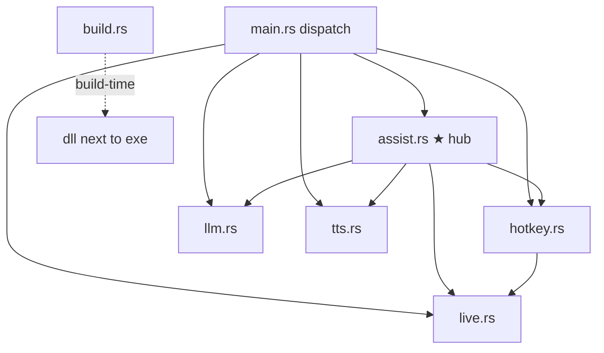
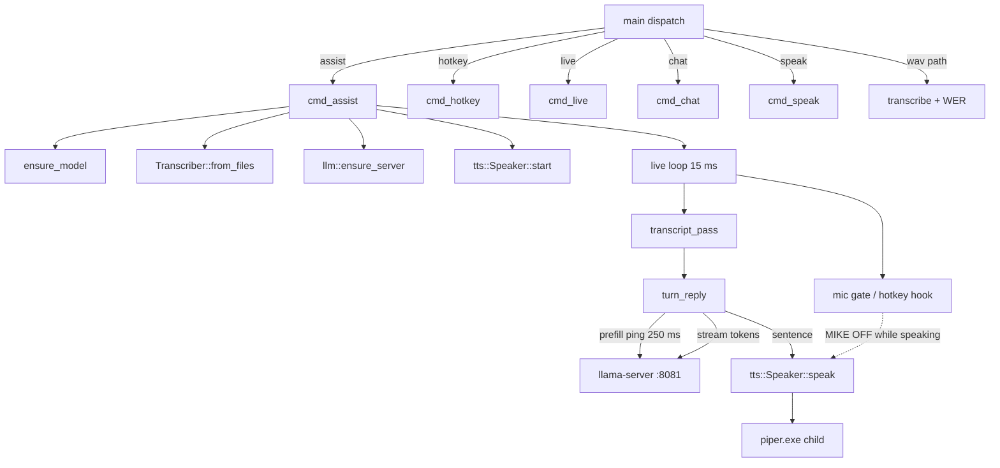

# GRAPH — igris-ai
Generated: 2026-11-12 | 7 source files | 4,259 LOC | mode: full

Terminal voice assistant: streaming Moonshine STT → LFM3-1.7B LLM (llama.cpp,
GPU-with-CPU-fallback) → piper TTS, with push-to-talk, hard mic mute during
playback, and sentence-by-sentence streaming speech.

## 1. Module graph

```
main.rs (296)  ── dispatch
├─ assist.rs (1007)  ★ hub — voice assistant command + live loop
│   ├─ live.rs   (713)  shared infra: mic session, audio ring, LiveRow status
│   ├─ hotkey.rs (649)  global CTRL+SPACE hook + fake-mic test rig
│   ├─ llm.rs    (504)  llama-server HTTP client (ChatML, KV-prefix reuse)
│   └─ tts.rs    (997)  piper speaker (file protocol, 3-slot WAV rotation)
├─ hotkey.rs ──> live.rs
├─ llm.rs     (standalone)
├─ live.rs    (standalone)
├─ tts.rs     (standalone)
└─ build.rs (93)  build script — onnxruntime.dll copy (see problem_faced.md)
```



No orphans (every module is reachable from `main`), no cycles, no self-edges.

## 2. External dependencies

| Crate | Purpose |
|---|---|
| `moonshine-rs 0.2.9` | Streaming Moonshine STT (small/medium), onnxruntime API 23 bundled |
| `ureq 3` (json) | Blocking HTTP client → llama-server `/health`, `/v1/completions` |
| `serde_json` | Chat history, ChatML rendering, LLM request/response bodies |
| `cpal 0.18` | Microphone capture (hotkey-gated) |
| `windows` (via hotkey.rs) | Global keyboard hook for CTRL+SPACE |

| External process | Purpose |
|---|---|
| `llama-server.exe` | LLM serving on `127.0.0.1:8081`; auto-spawned, outlives the app. GPU build (`assets/llama-cpp/vulkan`) tried first, CPU build (`assets/llama-cpp/cpu`) is the automatic fallback (`--cpu` / `MOON_LLM_CPU=1` forces CPU) |
| `piper.exe` | TTS synthesis child, file-based protocol into `.tts-utt/tts_1..3.wav` rotation |
| onnxruntime.dll | Loaded in-process by moonshine-sys for STT (copied next to exe by build.rs) |

## 3. Execution flow

```
main.rs dispatch
├─ assist::cmd_assist            ← HOT PATH (voice assistant)
│   ├─ ensure_model (model manifest + download)
│   ├─ Transcriber::from_files   (moonshine STT, ORT in-process)
│   ├─ llm::ensure_server(cpu)   (llama-server spawn: gpu → cpu fallback)
│   ├─ tts::Speaker::start       (warm piper child)
│   └─ live loop (15 ms tick)
│       ├─ hotkey hook / mic gate      (hold=record; speaking=MIKE OFF)
│       ├─ transcript_pass             (streaming STT lines)
│       │   └─ turn_reply
│       │       ├─ llm::prefill        (250 ms partial-text pings, KV reuse)
│       │       ├─ llm::chat_stream    (token stream)
│       │       └─ tts::Speaker::speak (per sentence → piper → playback)
│       └─ status row (LISTENING / SPEAK / MIKE OFF)
├─ hotkey::cmd_hotkey            (STT push-to-talk test rig)
├─ live::cmd_live                (WAV streaming test)
├─ llm::cmd_chat                 (LLM test CLI, --cpu)
├─ tts::cmd_speak                (TTS test CLI)
└─ audio-file transcription      (WER evaluation)
```



**Hot path** = `cmd_assist → live loop → transcript_pass → turn_reply →
llm::prefill/chat_stream + tts::Speaker::speak` — the chain that turns a
spoken question into a spoken answer. Leaves (leaf functions): `open_mic`,
`transcript_pass`, `tts::Speaker::speak`, `llm::chat_stream`.

## 4. Insights

- **Hub module: `assist.rs`** (1007 LOC) — everything the assistant does
  flows through it; it is the only module importing three other modules.
- **Shared-infra hub: `live.rs`** — mic ring, status row, capture lifecycle
  are reused by both `assist.rs` and `hotkey.rs`; changes here have the
  widest blast radius.
- **Process boundary modules** (`llm.rs`, `tts.rs`) are deliberately
  standalone (no `crate::` imports) — they wrap external processes and can
  be unit-tested via their CLIs (`chat`, `speak`).
- **Fan-out hotspot**: `turn_reply` (assist.rs) — touches LLM streaming,
  TTS queueing, barge-in kill and the mic gate; the highest-churn function
  in the repo.
- **Future edge (planned)**: tool calling via ZeroClaw crates
  (`zeroclaw-tool-call-parser` + `zeroclaw-tools` + `zeroclaw-api::Tool`)
  would enter between `llm::chat_stream` and `tts::Speaker::speak` — the
  streamed tokens get scanned for tool calls, tools execute, results feed
  back into the LLM, and only the final prose reaches the speaker.

---

Summary: 7 files | 12 module edges | 0 cycles | 0 orphans | hub = assist.rs |
hot path = assist live-loop → turn_reply (LLM stream + piper TTS) |
graph file = graphyfy/GRAPH.md
