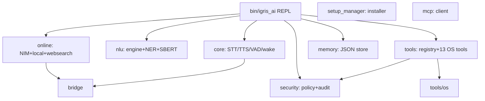

# GRAPH — igris-ai (IGRIS AI Standalone Voice Assistant)

Generated: 2026-10-31 | 48 source files (48 lib/bin + 2 examples + build.rs) | 17,918 LOC | mode: full

## 1. Module graph

### 1.1 Top-level subsystems (ASCII)

```
igris-ai (lib) ── bin/igris_ai.rs (REPL + agent loop, 521 LOC)
│
├─ core/             3,625 LOC  speech engines vendored from upstream
│    about(331) audio_capture(657) paths(155) piper_ffi(219) stt(265)
│    tts(898) vad(1317) wake_word(182)
├─ nlu/              3,723 LOC  local NLU subsystem (hub of internal fan-out)
│    context(580) engine(1056) mod(9) ner(491) nlu_processor(165)
│    sbert(750) sentence_splitter(212)
├─ online/            1,667 LOC  online/NIM + local fallback + web search
│    context(3) intent_router(75) local_reasoning(78) mod(80) reasoning(622)
│    stt(195) task_planner(224) web_search(120)
├─ tools/             3,573 LOC  capability-gated registry + OS control tools
│    dev(663) mod(1473) os/filetools(221) os/mod(745) os/systemui(471)
├─ setup_manager/    3,483 LOC  self-installer
│    downloader(499) extractor(580) mod(220) model_pack(369) permissions(284)
│    platforms/linux(507) macos(753) mod(149) windows(217) validator(242)
├─ mcp/                376 LOC  MCP client (transport, tool caller)
│    client(372) mod(4)
├─ bin/                660 LOC  binaries/examples (521 REPL + 95 mcp_server + 44 bench)
├─ bridge.rs           167 LOC  host seam
├─ lib.rs              88 LOC
├─ memory.rs           279 LOC
├─ security.rs         249 LOC
└─ (platform/link)     0 LOC
```

### 1.2 Real internal edges (current, from use crate::)

```
bin/igris_ai
 ├─ bridge · core::audio_capture · core::stt · core::tts · core::wake_word
 ├─ nlu::engine · online (mod/intent_router/reasoning/task_planner/local_reasoning/web_search)
 ├─ tools::default_registry · tools::os::*
 ├─ security (policy + audit) · memory

core   : stt→paths, tts→paths, audio_capture→paths, audio_capture→vad,
         wake_word→audio_capture, wake_word→stt, tts→bridge
nlu    : engine→ner, engine→sbert, context, nlu_processor→engine, sbert/ner→bridge
online : intent_router→task_planner, intent_router→reasoning
       : reasoning→bridge · local_reasoning relies on env Ollama
       : web_search→reqwest (external)
tools  : tools/mod → security, tools/os (registry registration)
       : os/mod → run_powershell (tokio::process)
       : os/filetools → PathPolicy, shared os runner
setup  : model_pack→core::paths; setup_manager root coordinates
mcp    : mcp/client (transport)
```

### 1.3 Mermaid (subsystem level)



## 2. Execution flow (summary)

```
REPL text
  online mode -> route_intent (LLM) -> execute_plan -> tools -> audit
  offline mode -> nlu.process_input -> route_intent outcome -> tools or local LLM (Ollama)
voice-loop: wake word -> STT -> nlu/online -> tool execution -> TTS
```

## 3. Key subsystems after modernization

- tools registry now exposes 5 + OS control suite (app/window/volume/power/brightness/screenshot/clipboard/file/search-trash/media/input/browser) plus docs/timers/reminders/weather; permission policy gates Standard/Sensitive/Admin tools.
- security hardening: one-shot single-use approvals, capability matrix with destructive tools non-grantable; strict shell/path sanitization; audit write warnings.
- WebSearch v2 checks Brave/Tavily.
- system control tools use PowerShell one-liners, WMI brightness, user32 input, VB file IO recycle-bin.

## 4. Orphans/Hotspots

- Hotspots: tools registry dispatch and PathPolicy; cmd grouping moderately.
- Orphan-ish: bench.rs, mcp_server.rs, dev.rs (examples/non-default).
- No intentional cycles detected at subsystem level.

## 5. Report (5 lines)

Source files: 48. Edges summarized: bin->{core,nlu,online,tools,security,memory}; tools->{security,os}; online->{bridge}; core->{bridge}. Hub modules: nlu/engine, tools/mod. Output path: `graphyfy/GRAPH.md`.
