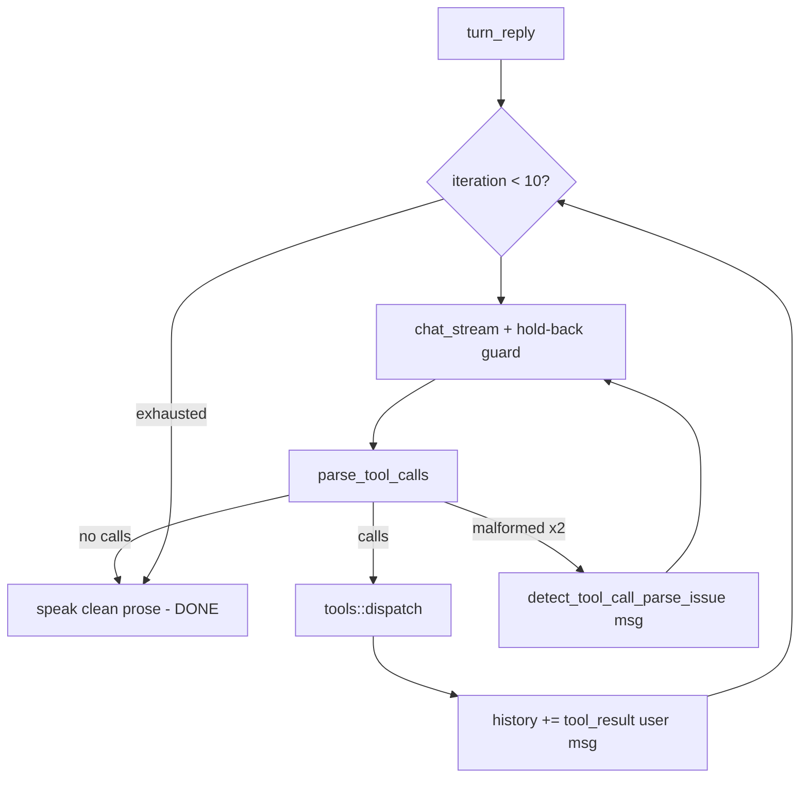

# Tool-Calling Integration Plan — igris-ai × ZeroClaw

Date: 2026-11-12 · Status: **PROPOSAL (awaiting review)** · Sources: two
verified deep-dives of `E:\major_project\igris\zeroclaw` (v0.9.0) + this
repo's code. All `file:line` citations were read, not guessed.

---

## 0. TL;DR

The voice assistant becomes a **voice agent**: spoken question → LLM decides
→ in-process tool execution → spoken answer. From ZeroClaw we take only the
small, high-value parts:

| Take | Size | Why |
|---|---|---|
| `zeroclaw-tool-call-parser` (vendored) | ~2.7k LOC code | battle-tested parser for JSON/XML/GLM/Perl tool-call syntaxes, think-tag stripping, malformed-JSON recovery |
| Prompt protocol block + "Available Tools" listing | ~40 lines | canonical, model-agnostic tool-use instructions |
| Agent-loop policy (max 10 iters, 2 malformed retries, result replay format) | ~120 lines of glue | proven numbers and message shapes |
| Tool registry pattern (imitate `tools/src/calculator.rs`) | our own ~300 LOC | ZeroClaw's real `zeroclaw-tools` crate drags config/providers/memory/sqlite — we skip it |

**We do NOT link** `zeroclaw-runtime` (424k LOC), `zeroclaw-channels`,
`zeroclaw-gateway`, `zeroclaw-memory`, or `zeroclaw-providers`. The final
artifact stays **one binary** (`igris-ai.exe`); llama-server and piper
remain the only child processes. No tokio — everything stays on the
current blocking/threads architecture.

**Prerequisite:** `rustup update` → rustc **1.96** (the vendored parser is
edition 2024; local toolchain is 1.95).

---

## 1. Verified ZeroClaw facts (evidence)

| Fact | Where |
|---|---|
| `parse_tool_calls(response) -> (String, Vec<ParsedToolCall>)` — returns cleaned text + calls | `crates/zeroclaw-tool-call-parser/src/lib.rs:2090` |
| `ParsedToolCall { name, arguments: serde_json::Value, tool_call_id: Option<String> }` | parser lib.rs |
| Parse order: strip-think → whole-response JSON → malformed recovery → MiniMax XML → tag loop (open/close tables `lib.rs:1038/1052`) → markdown fences → Perl/GLM | parser lib.rs |
| Parser's only `zeroclaw-api` use = `strip_think_tags` re-export (15 lines, `api/src/model_provider.rs:237-254`); only `zeroclaw-log` use = 2 warn sites (`lib.rs:2230, 2426`, helper `1870`) → trivially stubbed | deep-dive |
| Canonical protocol prompt: JSON object `{"name": ..., "arguments": {...}}` wrapped in the tool_call tag pair; "CRITICAL: output actual tags"; multi-call allowed; results arrive in tool_result tags | `crates/zeroclaw-runtime/src/agent/tool_call_format.rs:39-58` |
| Tool listing: `### Available Tools` + `**{name}**: {desc}` + `Parameters: {schema}`; specs **sorted by name** for byte-stable prompt-cache prefixes | `runtime/agent/loop_.rs:1340-1383`, `turn/tool_specs.rs:108-115` |
| Result replay: tool_result blocks (`name`, `status="ok|error"`) inside a **user message**; carrier line `[Tool results]` | `runtime/agent/dispatcher.rs:110-127`, `api/src/tool_carrier.rs` |
| Loop limits: `DEFAULT_MAX_TOOL_ITERATIONS = 10`, `MAX_MALFORMED_TOOL_PROTOCOL_RETRIES = 2` + `detect_tool_call_parse_issue` for the retry message | `runtime/agent/turn/mod.rs:205-220` |
| Prompt-guided mode for prompt-only servers (exactly our llama.cpp case): flatten role=tool history to text, no native schema needed | `providers/compatible.rs:3853-4078` |
| Stream safety: `looks_like_incomplete_tool_protocol_json` (hold-back), `StreamTerminalMarkerStripper` (`<|eom|>`/`<eom>` across chunks), `StreamTextGuard` (suppress envelopes from display) | `turn/stream_guard.rs:999` |
| Filtering hallucinated tool names against lowercase known-tool list | `turn/parse_response.rs:227-245` |
| llama.cpp may leak EOM/EOT marker tokens as text → `strip_trailing_terminal_markers` + `TERMINAL_MARKERS = ["<|eom|>", "<eom>"]` | parser lib.rs:45-65 |

---

## 1.5 "Why not just merge the WHOLE ZeroClaw?"

If the full runtime were linked, the generic machinery (registry, generic
tools, loop policy, config) would come free — but three things would
**still have to be written by us**, in every variant of this integration:

1. **The voice glue** — streaming STT turns, 250 ms prefill pings,
   sentence-by-sentence TTS, barge-in kill, mic-mute-during-playback,
   llama-server KV-prefix reuse. None of that exists in ZeroClaw; it is
   this app's core (`turn_reply` + `llm.rs`), and under a full merge it
   would be rewritten as adapters *into* ZeroClaw's loop instead of *our*
   loop — same LOC, less control.
2. **A custom Provider** for llama-server :8081 (hand-rendered ChatML,
   `/v1/completions`, KV-cache pings). ZeroClaw's OpenAI-compatible
   provider does not do our latency tricks.
3. **The goal.md tools themselves** — volume, screenshots, media keys,
   cargo, memory, window control. ZeroClaw ships shell/file/web/browser
   tools for *its* use cases, not ours. **The tools ARE the product**;
   no amount of merging ZeroClaw gives us IGRIS's capabilities.

What a full-runtime merge would additionally cost: tokio (our app is
blocking/threads), `zeroclaw-config` + sqlite + crypto in the binary,
~1.5 M LOC dependency tree, MSRV coupling, big compile times, and the risk
of losing the streaming/KV-cache behavior inside a batch-oriented agent
loop.

| Strategy | Free machinery | Still ours | Weight |
|---|---|---|---|
| A (this plan): vendor parser + own registry | parser | voice glue + provider + registry (~350 LOC) + tools | minimal (regex) |
| B: path-dep `api`+`parser`+`tools` | Tool trait + some generic tools | voice glue + provider + our tools | tokio + config + sqlite |
| C: embed full runtime | registry + loop + security + plugins | voice glue + provider + **all our tools** | ~1.5 M LOC, tokio, config |

A is the 80/20: we only write what we'd have to write anyway, and skip the
weight. Option C stays open for later (e.g. when MCP/WASM plugins become
desirable) — the vendored parser makes no assumption against it.

---

## 2. Target architecture

```
assist.rs::turn_reply                                ← becomes the agent loop
│
├─ (user turn appended to history as today)
│
└─ for iteration in 0..10:                           ← NEW loop
     ├─ llm::chat_stream(msgs, on_tok)               ← EXISTS, minor change
     │    on_tok:                                    ← + stream hold-back guard
     │      • strip terminal markers cross-chunk
     │      • hold back text that starts a tool-call
     │        tag / incomplete JSON envelope (never
     │        reaches TTS or the terminal mid-tag)
     │      • complete safe sentences → tts::Speaker (UNCHANGED)
     │
     ├─ toolparse::parse_tool_calls(full_text)       ← NEW (vendored)
     │    → (clean_text, calls)   [think tags + LFM3 think spans stripped]
     │
     ├─ calls empty?                                 ← plain answer turn
     │    → speak clean_text tail (existing flow), push assistant msg, DONE
     │
     └─ calls present?                               ← tool turn
          ├─ speak one short filler ("ek second…")   ← TTS UX
          ├─ tools::dispatch(name, args) per call    ← NEW registry
          │    (unknown name → error result, not a crash)
          ├─ history += assistant msg (clean_text + raw envelopes)
          ├─ history += user msg "[Tool results]" + tool_result blocks
          └─ loop again (LLM sees results, answers or calls more tools)
```



---

## 3. Component details

### 3.1 `src/toolparse.rs` — vendored parser (Phase 1)

- Copy `crates/zeroclaw-tool-call-parser/src/lib.rs` (2,723 code lines) into
  `src/toolparse.rs`; keep a **trimmed subset** of its inline test suite.
- Header comment: upstream path, commit, `MIT OR Apache-2.0` license notice.
- Replace the `zeroclaw_api::strip_think_tags` re-export with our own copy
  (port of `api/src/model_provider.rs:237-254`) **extended for LFM3**:
  also strip `<Token 1437>` … `<Token 9550>` think spans.
- Stub the 2 `zeroclaw_log` warn calls (2230, 2426 + helper 1870) with
  `eprintln!` (or `log::warn!` if we add the `log` crate — not required).
- Trim `map_tool_name_alias` to identity + our aliases only.
- New dependency: `regex = "1"` (serde/serde_json already in the tree).
- API we actually use: `parse_tool_calls`, `strip_trailing_terminal_markers`
  (extend `TERMINAL_MARKERS` with `<|eot_id|>` in case llama.cpp leaks it),
  `strip_tool_result_blocks`, `looks_like_incomplete_tool_protocol_json`,
  `looks_like_tool_protocol_envelope`, `contains_parseable_tool_call`,
  `detect_tool_call_parse_issue`.

*Alternative kept open:* path-depend on `crates/zeroclaw-tool-call-parser`
(upstream-trackable) — but that pulls `zeroclaw-api` (tokio + async-trait,
15k LOC) and `zeroclaw-log` (tracing-subscriber) into the binary just for
one function and two warns. Recommended: **vendored**.

### 3.2 Prompt protocol — `llm.rs` (Phase 2)

- New `ToolSpec { name, description, parameters_schema: serde_json::Value }`.
- `tools_protocol_block(specs) -> String`: ZeroClaw's
  `TOOL_CALL_PROTOCOL_INSTRUCTIONS` **verbatim** + `### Available Tools`
  listing; specs sorted by name (byte-stable → llama-server KV cache and our
  prefill pings keep hitting the same prefix).
- Assembled **once** and appended to `VOICE_SYSTEM_PROMPT` when the history
  is seeded (assist.rs:658) — the system turn never changes mid-session.
- 1–2 few-shot examples inside the protocol block (LFM3-1.7B is small; the
  fenced example in ZeroClaw's block already serves this — keep it).
- `render_prompt` needs no changes: tool results are plain user messages.

### 3.3 `src/tools.rs` — dynamic tool registry (Phase 3)

No tokio, no traits ceremony — a **runtime registry**, not a hardcoded
table. The registry is the product; individual tools are its tenants:

```rust
pub struct ToolDef {
    pub name: String,
    pub desc: String,
    pub schema: serde_json::Value,
    pub run: Box<dyn Fn(&serde_json::Value) -> Result<String, String> + Send>,
}

pub struct Registry { tools: Vec<ToolDef> }
impl Registry {
    fn register(&mut self, t: ToolDef);
    fn specs(&self) -> Vec<ToolSpec>;   /* feeds the prompt block, sorted */
    fn dispatch(&self, name: &str, args: &Value) -> Result<String, String>;
}
```

**Dynamism ladder** — tool calling stays dynamic at every level:

| Level | Tool source | When |
|---|---|---|
| 1 | Built-in tools registered in code (seed set below) | v1 |
| 2 | **Config-defined tools**: user adds entries to `tools.toml` — name, description, JSON schema, allowlisted command template with `{arg}` substitution. New tool without a recompile | v1.1 |
| 3 | External tool servers (MCP) / WASM plugins — ZeroClaw's `zeroclaw-plugins` pattern | v3 |

Because `tools_protocol_block` is **generated from the registry every
session**, adding or removing a tool automatically changes what the LLM can
call — and the LLM's tool selection + argument generation were dynamic from
day one (one `open_app` tool covers "Open Chrome", "Open VS Code", "Open my
coding project" purely through generated arguments; the goal.md tables are
examples of reachable outcomes, not a fixed tool list).

Seed set (v1 — the first tenants of the registry):

| Tool | Behavior | Risk class |
|---|---|---|
| `get_time` | current date/time, `chrono` or `std` formatting | read-only |
| `calculate` | arithmetic eval (port pattern of `zeroclaw-tools/src/calculator.rs`) | read-only |
| `open_app` | launch from a **hard allowlist** (e.g. notepad, calc, chrome, spotify) via `std::process::Command` — no shell, no arbitrary paths | gated |
| `web_fetch` | `ureq` GET (already a dep), text-only, size-capped | read-only (v1.1) |
| `create_note` | write a text file **inside the workspace only** (PathGuardedTool idea, borrowed) | gated (v1.1) |

Security policy for voice use:
- **No arbitrary shell execution in v1** (ZeroClaw's `shell` tool is
  explicitly not ported).
- `open_app` allowlist is a `const` in tools.rs; anything else → error
  result telling the model the app isn't available.
- Every tool has a timeout; a hung tool returns `status="error"` and the
  loop continues (voice UX must never deadlock).
- Sequential execution only (voice context; ZeroClaw's parallel rules stay
  out of scope).
- Escape hatch: `--no-tools` flag / `MOON_NO_TOOLS=1` drops the protocol
  block from the prompt → assistant behaves exactly as today.

### 3.4 Agent loop — `turn_reply` (Phase 4)

- Wrap the existing body in the iteration loop (max **10**, per ZeroClaw).
- **Streaming hold-back** in `on_tok` (borrowed from `stream_guard.rs`):
  buffer tokens; a sentence goes to TTS only if the accumulated stream does
  NOT start a tool-call tag / incomplete JSON envelope
  (`looks_like_incomplete_tool_protocol_json`). False positives just speak a
  sentence slightly late — never lose text; false negatives never speak a
  tool-call envelope aloud.
- Terminal-marker stripping across chunk boundaries
  (`StreamTerminalMarkerStripper` concept) so `<|eom|>` never reaches TTS.
- **Tool turn UX**: speak a short filler ("ek seconds…") once per tool turn;
  the final prose answer streams normally.
- **Malformed retry**: if the stream looks like a tool envelope but
  `parse_tool_calls` yields nothing, use `detect_tool_call_parse_issue` to
  compose a corrective user message ("your last tool call was malformed: …")
  and retry — max **2** retries (ZeroClaw's number), then fall through to
  plain-text handling.
- **Barge-in** (`stop_when`) cuts the whole loop as today (in-flight TTS
  killed; loop exits on next token check).
- History stays `Vec<Value>`: assistant message keeps the raw envelopes
  (so the model sees its own format next turn), results go into a user
  message with the `[Tool results]` carrier + tool_result blocks — prefix
  stability preserved for `cache_prompt` + `--cache-reuse 1`.

### 3.5 LFM3-1.7B fit

- No native function-calling needed: we use ZeroClaw's **prompt-guided**
  mode (their llama.cpp-compatible path), i.e. instructions + robust parser.
- Strict, simple format (JSON object in one tag pair) + the fenced example
  in the protocol block — suited to a 1.7B model at 16 tok/s (CPU) / 33 tok/s
  (GPU).
- Think spans (`<Token 1437>` … `<Token 9550>`) stripped before parsing;
  llama.cpp may render special tokens as text — covered by the extended
  `strip_think_tags` + terminal-marker list.
- Future option (not v1): llama.cpp grammar-constrained output
  (`json_schema` param on /v1/completions) to force valid tool JSON.

---

## 4. Build phases & tests

| Phase | Work | Verify |
|---|---|---|
| 0 | `rustup update` → 1.96; `cargo check -p zeroclaw-tool-call-parser` inside `E:\major_project\igris\zeroclaw` (sanity) | builds |
| 1 | Vendor parser → `src/toolparse.rs`, stubs, LFM3 think-strip, add `regex` | `cargo test` (parser subset) |
| 2 | `ToolSpec` + protocol block in `llm.rs`; sorted specs; `--no-tools` flag | `chat` CLI shows block in debug dump |
| 3 | `src/tools.rs` registry + `get_time`, `calculate`, `open_app` | unit tests per tool |
| 4 | Agent loop in `turn_reply`: hold-back, filler, retries, result replay | CLI e2e: "what time is it" → tool call → spoken/printed time |
| 5 | Voice e2e + regression | `assist --hotkey`: spoken time question; plain chat unchanged; prefill ping latency unchanged |

Each phase compiles and commits separately. Estimated new hand-written code:
**~500 LOC** (tools.rs + llm.rs + assist.rs glue) + ~2.7k vendored parser.

## 5. Impact

- Deps: +`regex`. No tokio, no sqlite, no new HTTP stack.
- Binary: roughly +1–2 MB. RAM/VRAM profile unchanged; prompt grows by the
  protocol block (~250–400 tokens) — negligible for prefill, and it sits in
  the stable prefix.
- Toolchain: rustc ≥1.96 required (edition 2024 vendored code). One-time
  `rustup update`.
- Startup: unchanged (no new processes; tools run in-process or as short
  child commands).

## 6. Decision points (your call)

1. **Vendored parser** (recommended) vs path-dep on the ZeroClaw crate
   (upstream tracking, heavier binary).
2. **Seed tool set** — `get_time` / `calculate` / `open_app` as the first
   registry tenants; config-defined `tools.toml` tools in v1.1?
3. **open_app allowlist** — which apps? (default suggestion: notepad, calc,
   chrome, spotify, vscode)
4. Tools **always-on** with `--no-tools` escape, or opt-in `--tools` flag?
5. rustup update now (required for v1 anyway) — ok?

## 7. Risks & mitigations

| Risk | Mitigation |
|---|---|
| LFM3-1.7B emits malformed JSON | parser's malformed-recovery paths + 2 retries + few-shot example + strict format |
| Model hallucinates tool names | filter against registry (ZeroClaw pattern); unknown → error result back to model |
| Tool-call envelope spoken aloud | stream hold-back guard + terminal-marker stripping |
| Hung tool blocks the loop | per-tool timeout → error result |
| Prompt-cache misses | tool block in stable system turn; specs sorted; results appended at the end only |
| Vendored parser drift | upstream commit noted in the file header; ZeroClaw repo stays cloned for diffs |

## 8. Future upgrades (out of scope for v1)

- Grammar-constrained tool JSON via llama.cpp `json_schema`.
- More ZeroClaw tools (web_fetch mature, files, weather API).
- WASM/MCP plugin bridge (`zeroclaw-plugins`) if we ever need external tools.
- Parallel tool execution; spoken confirmation for destructive ops.
